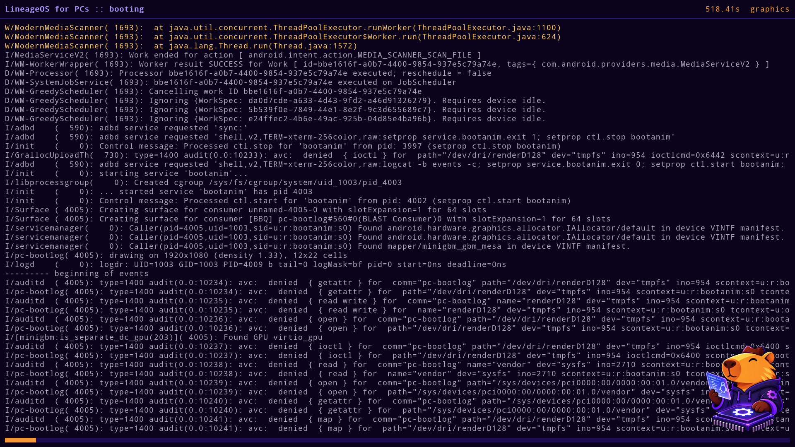
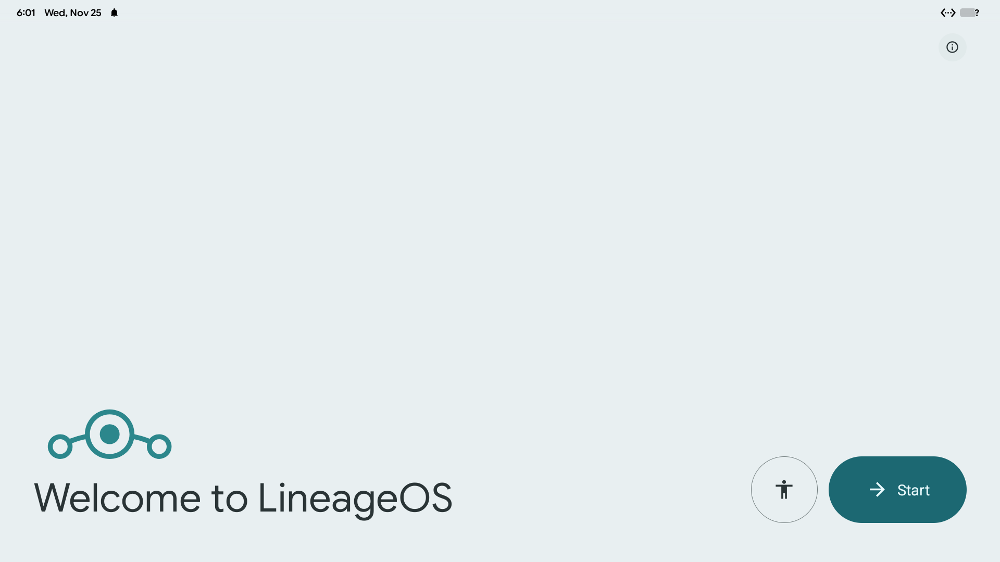
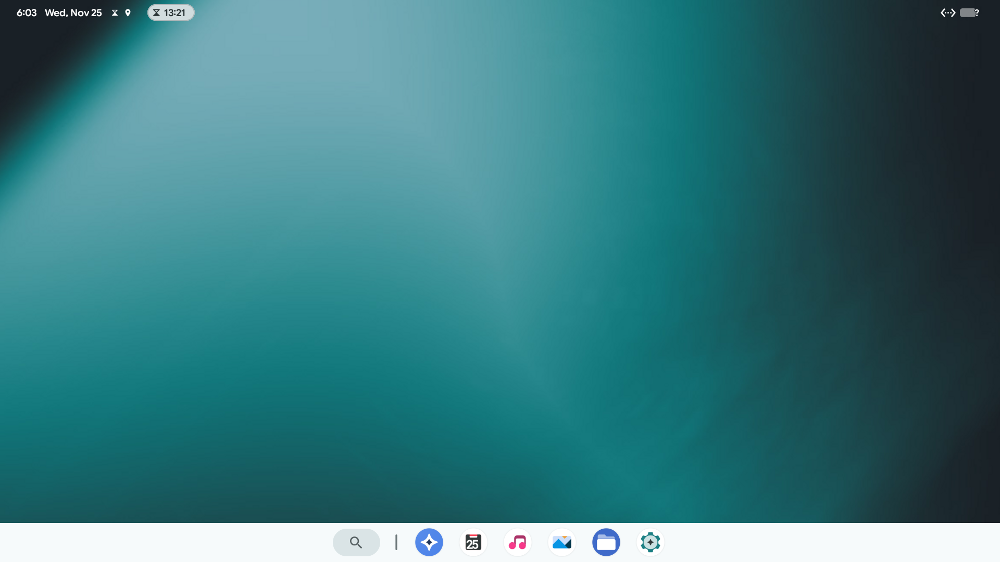
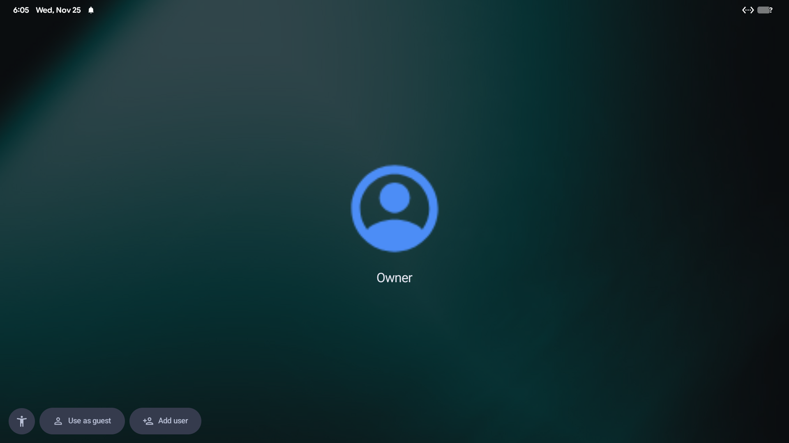

# LineageOS 24.0 for x86_64 PCs

Device tree for `lineage_pc_x86_64`: LineageOS (Android 17) on ordinary PCs, installed into a folder on
an existing partition and booted through GRUB, in the spirit of Android-x86 and BlissOS.

## Status

| Part | State |
|---|---|
| Product, board, lunch | builds (`system.img`, live ISO) |
| Kernel | upstream 7.2 with Fedora's config + Android requirements, built with AOSP clang |
| Graphics | Mesa (radeonsi, iris, crocus, r600, nouveau, virgl, svga, softpipe; RADV, ANV, venus), minigbm on Mesa's GBM, drm_hwcomposer — virgl checked in QEMU/KVM (`virtio-vga-gl`); VMware and VirtualBox need their SVGA with 3D acceleration on (VirtualBox: VMSVGA) |
| Boot | `pc-init` initrd (folder install, live ISO) — the live ISO boots to the desktop in QEMU/KVM; UEFI Secure Boot through shim + MOK checked in QEMU (shim, GRUB, signed kernel) |
| HALs | AOSP software HALs, AIDL audio over ALSA, Wi-Fi (nl80211), Bluetooth, USB cameras — they start in QEMU; on real hardware not yet |
| Installer | `PcInstaller` app + `pc-installd` root service ([packages/apps/PcInstaller](https://github.com/mateusseiboth/android_packages_apps_PcInstaller)), UEFI and BIOS, install, update (also from a USB drive on an installed system) and removal; GRUB's BIOS boot sector checked in QEMU, Android not yet booted |
| Desktop UI | [vendor/pc/ui](https://github.com/mateusseiboth/android_vendor_pc_ui) + `pc` branches of frameworks/base and Launcher3 — runs in QEMU/KVM (screenshots below) |
| Linux terminal | AVF (`com.android.virt`, crosvm, Terminal app) on KVM, non-protected VMs — built, not yet run (needs a PC, not a VM) |
| Boot log | `pc-bootlog`: the live log as a terminal instead of the boot animation — runs in QEMU/KVM |

## Sources

Sync LineageOS 24.0 with the projects of LineageOS for PCs on top. They are listed in
[`local_manifest.xml`](local_manifest.xml), the same file the ISOs are built from:

```sh
repo init -u https://github.com/LineageOS/android.git -b lineage-24.0 --git-lfs
mkdir -p .repo/local_manifests
curl -o .repo/local_manifests/pc.xml https://raw.githubusercontent.com/mateusseiboth/android_device_pc_x86_64/lineage-24.0/local_manifest.xml
repo sync
device/pc/pc_x86_64/patches/apply.sh
```

`patches/apply.sh` applies the few fixes this tree carries for projects it does not fork
(`patches/<project path>/*.patch`, with `git am`, so the original author stays); run it again after every
`repo sync`, it skips what a project already has. Today: Mesa's BLORP fix for Sandy Bridge and older
Intel graphics from Mesa 26.1.2 (garbled text and images on Mesa 26.1,
[mesa#15435](https://gitlab.freedesktop.org/mesa/mesa/-/issues/15435)).

Forks: [minigbm](https://github.com/mateusseiboth/android_external_minigbm) keeps GloDroid's sources
(from android-generic) with Android 17's build files plus AIDL/stable-C `gbm_mesa` variants;
[aospext](https://github.com/mateusseiboth/android_glodroid_aospext) builds radeonsi without LLVM and
only pulls libva when VA is enabled.

## Apps and projects

Everything below is ours and open source (the repositories are listed in `local_manifest.xml`, except the
two that live outside the Android tree).

**Apps of the system**

| Project | What it is |
| --- | --- |
| [PcInstaller](https://github.com/mateusseiboth/android_packages_apps_PcInstaller) | Installs the system from the live USB stick, and once installed it is **System updates**: updates and patches, from a file or online. |
| [PcFiles](https://github.com/mateusseiboth/android_packages_apps_PcFiles) | **Files**, the file manager (it replaces the stock Files app; partitions mounted by Disks show there too). |
| [PcTerminal](https://github.com/mateusseiboth/android_packages_apps_PcTerminal) | **Terminal** and Linux containers (Debian, Ubuntu, Fedora, Arch...), with its root service pc-containerd. |
| [PcWayland](https://github.com/mateusseiboth/android_packages_apps_PcWayland) | Runs Linux apps as windows of their own (Wayland and X11 with GPU acceleration, sound). |
| [PcPrint](https://github.com/mateusseiboth/android_packages_apps_PcPrint) | **Printers and scanners**: prints to network and USB printers without drivers, scans with eSCL scanners. |
| [PcDisks](https://github.com/mateusseiboth/android_packages_apps_PcDisks) | **Disks**: partitions, mounting, formatting, labels and disk health. |
| [PcRemote](https://github.com/mateusseiboth/android_packages_apps_PcRemote) | **Remote desktop**: lets another computer connect to this one by RDP, switched on in Settings. |
| [PcClipboard](https://github.com/mateusseiboth/android_packages_apps_PcClipboard) | Clipboard history: texts, images and links copied recently, one click away in the status bar. |
| [PcTaskManager](https://github.com/mateusseiboth/android_packages_apps_PcTaskManager) | **Task manager**: what is running, how much CPU and memory it uses, and a way to end an app. |
| [PcDiagnostics](https://github.com/mateusseiboth/android_packages_apps_PcDiagnostics) | **Diagnostics**: live CPU, memory, storage, battery and network readings, and testers for the keyboard, touchpad, speakers, microphone and more. |
| [PcTextEditor](https://github.com/mateusseiboth/android_packages_apps_PcTextEditor) | **Text editor** for plain text files. |
| [PcViewer](https://github.com/mateusseiboth/android_packages_apps_PcViewer) | **Viewer**, the default app for images, SVG, PDFs, text, audio and video. |
| [PcClocks](https://github.com/mateusseiboth/android_packages_apps_PcClocks) | Lock screen clock styles for the style picker. |
| [PcLogin](https://github.com/mateusseiboth/android_packages_apps_PcLogin) | The login screen: the people who use the PC, each with their own PIN or password if they set one. |

**Outside the Android tree**

| Project | What it is |
| --- | --- |
| [rdp-client-android](https://github.com/mateusseiboth/rdp-client-android) | A Remote Desktop (RDP) client for any Android, also published on its own. |
| [lineage-pc-updates](https://github.com/mateusseiboth/lineage-pc-updates) | The update list the System updates app reads, with the changelog. |

**Forks** (changes to LineageOS, AOSP and other projects, credited in each one)

| Project | What it is |
| --- | --- |
| [frameworks/base](https://github.com/mateusseiboth/android_frameworks_base) | The desktop: status bar, notifications, windows, task bar (SystemUI and WM Shell). |
| [Launcher3](https://github.com/mateusseiboth/android_packages_apps_Launcher3) | The desktop, app list and task bar. |
| [vendor/pc/ui](https://github.com/mateusseiboth/android_vendor_pc_ui) | The desktop's overlays and feature flags. |
| [Settings](https://github.com/mateusseiboth/android_packages_apps_Settings) | Settings for a computer (monitors, battery only when there is one, remote desktop). |
| [SetupWizard](https://github.com/mateusseiboth/android_packages_apps_SetupWizard) | The first-boot setup. |
| [frameworks/native](https://github.com/mateusseiboth/android_frameworks_native) | SurfaceFlinger with two screens: the built-in one paces the frames. |
| [Connectivity](https://github.com/mateusseiboth/android_packages_modules_Connectivity) | Local network access for the Linux containers. |
| [drm_hwcomposer](https://github.com/mateusseiboth/android_external_drm_hwcomposer) | Screen output on any GPU (opens every DRM card, smooth on two monitors). |
| [minigbm](https://github.com/mateusseiboth/android_external_minigbm) | Graphics buffers for every GPU through Mesa (gbm_mesa). |
| [aospext](https://github.com/mateusseiboth/android_glodroid_aospext) | Builds Mesa inside the Android build. |
| [adb](https://github.com/mateusseiboth/android_packages_modules_adb) | adb root for the signed-in user. |
| [logging](https://github.com/mateusseiboth/android_system_logging) | System apps read the logs without a consent dialog. |
| [FreeRDP](https://github.com/mateusseiboth/FreeRDP) | FreeRDP, the RDP library behind the remote desktop and the RDP client. |

## Build

```sh
# once: your Secure Boot key pair (see "Secure Boot keys for your build") and Fedora's shim
device/pc/pc_x86_64/secureboot/make_keys.sh           # -> $PC_SECUREBOOT_KEYS (default ../keys)
device/pc/pc_x86_64/secureboot/fetch_shim.sh          # -> out/secureboot/shim
# once: host tools for Mesa's Intel drivers (needs llvm22-devel clang22-devel libclc22-devel
# libclc22-spirv spirv-llvm-translator22-devel on Fedora 45)
meson setup ... external/mesa3d  # see "Mesa host tools" below
device/pc/pc_x86_64/kernel/stage_firmware.sh          # /lib/firmware -> vendor/pc/firmware
device/pc/pc_x86_64/kernel/build_kernel.sh            # -> out/kernel-pc (modules signed with your key)
source build/envsetup.sh && lunch lineage_pc_x86_64-cp2a-userdebug && m systemimage
python3 device/pc/pc_x86_64/iso/build_iso.py out/lineage-pc.iso   # signs GRUB and the kernel with your key
```

Host tools: AOSP's prebuilts plus `grub2-mkimage` (Fedora's grub2 2.12 with `--sbat`), `sbsign`/`sbverify`
(sbsigntools), `openssl`, `xorriso`, `mtools`, `dosfstools`, `curl`, `rpm2cpio` and `cpio`.

On a 32 GB machine Soong's analysis needs help: a large zstd zram, `GOGC=50 GOMEMLIMIT=20GiB`, and the
`PRODUCT_SOURCE_ROOT_DIRS` exclusions in `device.mk` (other platforms' trees).

### Mesa host tools

Mesa 26's Intel drivers precompile OpenCL shaders with `mesa_clc` and `vtn_bindgen2`. Build them on the
host from `external/mesa3d` (LLVM 22, `-Dmesa-clc=enabled -Dinstall-mesa-clc=true`, every driver off)
and copy both binaries to `prebuilts/mesa-build-deps/`, which aospext puts on the PATH.

## Secure Boot

UEFI boots with Secure Boot on through [shim](https://github.com/rhboot/shim) and a Machine Owner Key (MOK):

```
firmware (Microsoft's keys) -> shimx64.efi (Fedora's, signed by Microsoft)
    -> grubx64.efi (signed with your key, SBAT inside) -> kernel (signed with your key, verified by shim for GRUB)
    -> kernel modules (signed with your key at modules_install; the kernel embeds the certificate)
```

The first start with Secure Boot on: shim cannot verify GRUB yet and opens MokManager. Press Enter on the
error, then any key within 10 seconds, choose "Enroll key from disk", the `LINEAGE_PC` volume and
`ENROLL_THIS_KEY_IN_MOKMANAGER.der`, then "Continue", "Yes" and "Reboot". From then on that computer boots
every build signed with the same key. The ISO carries the same steps in pt-BR and English as
`SECURE_BOOT.txt` (root of the stick's EFI partition and `lineage/`), and its GRUB menu shows them in
"Secure Boot: help (ajuda)". The installer puts shim, MokManager, the signed GRUB and the `.der` in
`EFI/LineageOS` and points the UEFI boot entry at shim; when the key is not enrolled it offers to queue the
enrollment (as `mokutil --import` does), so the next start only asks to confirm it with a password.

### Secure Boot keys for your build

Every build is signed with the builder's own key pair; nothing in the tree holds one.

1. Generate it once: `device/pc/pc_x86_64/secureboot/make_keys.sh`. It writes to `$PC_SECUREBOOT_KEYS`
   (default: `keys/` beside the source tree, e.g. `~/android/keys` for a tree in `~/android/lineage`) and
   refuses a directory inside a git work tree. `PC_SECUREBOOT_NAME` sets the name MokManager shows.
2. Keep the private key out of git and never publish it: `pc-secureboot.key` and `pc-secureboot.pem` (key +
   certificate). Back them up: a new pair means every computer has to enroll again.
3. Build the kernel and the ISO with the same `PC_SECUREBOOT_KEYS`: `build_kernel.sh` signs the modules with
   `pc-secureboot.pem`, `build_iso.py` signs GRUB and the kernel with `pc-secureboot.key`/`.crt` and copies
   `pc-secureboot.der` to the ISO as `ENROLL_THIS_KEY_IN_MOKMANAGER.der`.
4. Users enroll your `.der` in MokManager (above), once per computer.

A build without keys is refused before anything is built, with the missing files and what to run.
`PC_SHIM_DIR` points the ISO build at another `shimx64.efi` + `mmx64.efi` pair (default
`out/secureboot/shim`, filled by `fetch_shim.sh`, which pins the files' SHA-256).

### What Secure Boot changes in the kernel

- Upstream 7.2 has no `CONFIG_LOCK_DOWN_IN_EFI_SECURE_BOOT` (a Fedora patch; the line in Fedora's config
  has no effect), so the lockdown LSM stays at `none`: kexec, `/dev/mem`, debugfs, BPF and the rest behave as
  without Secure Boot. Checked in QEMU: `/sys/kernel/security/lockdown` reads `[none]`.
- IMA's architecture policy (`CONFIG_IMA_ARCH_POLICY`, Fedora's) sees Secure Boot and turns on module and
  kexec signature enforcement: `/sys/module/module/parameters/sig_enforce` reads `Y`. That is why every
  module is signed (`CONFIG_MODULE_SIG_ALL`); `MODULE_SIG_FORCE` stays off, so without Secure Boot unsigned
  modules still load. Android needs no kexec.
- `BoardConfig.mk` sets `BOARD_DO_NOT_STRIP_VENDOR_MODULES`: the build's own strip would drop the signature.
- shim mirrors the MOK list to the kernel, which loads it into its platform and machine keyrings.

### Checking it

`secureboot/sb_boot_test.py out/lineage-pc.iso` boots the ISO in QEMU with OVMF's Secure Boot firmware and
Microsoft's keys (1 GiB, no display): the first start refuses GRUB and the test enrolls the key in MokManager
the way a user does; then the stick and the DVD boot the kernel ("Secure boot enabled" in its log), and
SeaBIOS boots it from the DVD and the stick. Also checked by hand in QEMU: GRUB refuses an unsigned kernel
("bad shim signature"), and a key queued by pc-installd's MokNew/MokAuth code is enrolled by MokManager after
its password and then shows up in `MokListRT`.

## Layout of an install

```
<partition>/lineage/
    kernel            bzImage
    initrd.img        pc-init
    system.img        or system/ (the image's files extracted)
    system.old.img    previous system after an update (or system.old/)
    data.img          or userdata/ (created on first boot)
    install-<id>.id   written by the installer; GRUB and pc-init find the folder by it
```

On UEFI the installer puts shim, MokManager and GRUB in `EFI/LineageOS/` on the ESP (`shimx64.efi`,
`mmx64.efi`, the signed `grubx64.efi` and the `.der` from the ISO), adds a UEFI boot entry for shim, and
fills `EFI/BOOT/` (shim as `BOOTX64.EFI`, GRUB and MokManager beside it) only when it is empty or ours. On BIOS it writes `grub-pc/boot.img` to
the disk's first sector and `grub-pc/core.img` before the first partition (a GPT BIOS boot partition, the GPT
gap or the MBR gap), and keeps GRUB's modules and menu in `pc-grub/` on the install's partition. Every menu
lists every install on the computer plus the other systems it finds (Windows, other Linux).

Kernel command line: `pc.src=<folder>` (default `lineage`), `pc.live=1` (data in RAM),
`pc.previous=1` (boot the previous system), `pc.id=<id>` (only a folder holding `install-<id>.id`; the
live ISO uses `pc.id=live`, so a USB stick and an installed system never boot each other), plus `androidboot.hardware=pc` and
`firmware_class.path=/vendor/firmware`. The system image or folder must live on a Linux file system
(ext4, f2fs, btrfs) when extracted; on NTFS/exFAT use `system.img` and `data.img`.

## Linux terminal

The Terminal app runs a Debian VM through the Android Virtualization Framework, as on Googlebook. A PC has
no pKVM, so only non-protected VMs run, on the kernel's KVM.

- `device.mk` inherits `packages/modules/Virtualization/build/apex/product_packages.mk`: it sets
  `PRODUCT_AVF_ENABLED` (the `com.android.virt` APEX with crosvm, virtmgr and, through the release flag
  `RELEASE_AVF_SUPPORT_CUSTOM_VM_WITH_PARAVIRTUALIZED_DEVICES`, `VmTerminalApp`) and installs the
  `android.software.virtualization_framework` feature. Remote attestation is off
  (`PRODUCT_AVF_REMOTE_ATTESTATION_DISABLED`): it needs protected VMs.
- The kernel has KVM (Intel and AMD), vhost-vsock, AF_VSOCK, TUN and the bridge built in (`kernel/pc.config`).
- `terminal/pc-hypervisor.sh` runs at `post-fs`: when the kernel registered the kvm device (VT-x/AMD-V
  enabled in the firmware) it sets `vendor.pc.kvm`, and `init.pc.rc` then sets
  `ro.boot.hypervisor.vm.supported` and `hypervisor.memory_reclaim.supported` (memory balloon).
  `ro.boot.hypervisor.protected_vm.supported` is always false. A value given on the kernel command line
  (`androidboot.hypervisor.vm.supported=0`) wins.
- `terminal/pc-terminal-default-permissions.xml` grants the terminal local network access and
  notifications up front.
- Turn it on in Settings > System > Developer options > Linux development environment. Settings offers it
  only with VMs supported, at least 4 GB of RAM and 16 GB of storage.
- On first start the app downloads the Debian image (`images.tar.gz`) from Google's servers
  (`https://dl.google.com/android/ferrochrome/<version>/x86_64/`). On a userdebug build a local
  `/sdcard/linux/images.tar.gz` is used instead; `packages/modules/Virtualization/build/debian/build.sh`
  builds one.

SELinux is permissive. For enforcing, besides the rest of the vendor policy: crosvm and virtmgr are
private platform domains that vendor policy cannot name, so anything they need beyond AOSP's rules (for
example the GPU render node when a VM uses a GPU backend other than `2d`) goes into system_ext private
policy (`SYSTEM_EXT_PRIVATE_SEPOLICY_DIRS`).

## Boot log

The boot animation is a terminal showing the live log (`logcat -b all`: kernel, main, system, events),
colored by priority, with the time since boot, the current stage, a progress bar driven by the
`boot_progress_*` events and the logo in the corner. It is the native version of the boot log of the
[HY300 projector build](https://github.com/mateusseiboth/hy300-rk3566/tree/main/android/bootlog), with the same
log model, stages and look: C++ drawing on the CPU into a SurfaceFlinger layer, so the log shows as soon
as SurfaceFlinger is up, with no Java VM competing with zygote.

- `bootlog/pc-bootlog.rc` overrides frameworks/base's `bootanim` service with `/system_ext/bin/pc-bootlog`.
  SurfaceFlinger starts that service with `ctl.start` after setting `service.bootanim.exit=0`, and
  WindowManager sets the property to 1 and waits for the service to stop before turning the screen on;
  nothing else changes. The override lives on system_ext because init refuses a vendor file overriding a
  system service.
- It runs as user `graphics` with the `log` group (logd hands every buffer to that group; no root) in the
  `bootanim` domain: `sepolicy/private` (system_ext private policy) labels the binary `bootanim_exec`,
  lets the domain read the log (`read_logd`) and run the stock animation.
- The drawing runs in a child process. When it cannot draw (no display, no font, no surface) or dies
  before the boot asked the animation to leave, the service process runs the stock
  `/system/bin/bootanimation` in its place, keeping the pid WindowManager watches.
- It leaves when `service.bootanim.exit` goes from 0 to 1 or when `boot_progress_enable_screen` shows up
  in the log; it never holds the boot. A 10-minute guard hands over to the stock animation.
- Text: DroidSansMono glyph strips with ASCII and Latin-1 (`bootlog/font/`, made on the host by
  `font/make_font.py`), 12x22 or 17x32 at an integer scale, picked for about 48 rows on the short side
  of the screen, or larger on a dense display. 1080p shows a 158x45 terminal. The log and the stage
  names are decoded as UTF-8, so Portuguese keeps its accents; characters outside Latin-1 show as `?`.
  Stage names in Brazilian Portuguese or English, from `persist.sys.locale` (`ro.product.locale`
  before the user picks one).
- Logo: `bootlog/logo.png`, scaled once at boot to a fifth of the short side; the terminal's purple and
  orange come from it.
- `androidboot.pc.bootlog=0` on the kernel command line runs the stock animation instead.
- `adb shell /system_ext/bin/pc-bootlog --test` draws for 15 s over the running system.

The model and the drawing (`bootlog_model.*`, `bootlog_render.*`) have no Android dependencies:
`bootlog/test_bootlog.py` builds their gtest suite with the host compiler, using the tree's
`external/googletest` (outside the tree, set `ANDROID_BUILD_TOP`); in the build it is `pc-bootlog-test`.

## Debugging a real PC

Most PCs have no serial port, so the GRUB entry **LineageOS (debug: adb over network)** turns adb on over
TCP 5555 from boot (`androidboot.pc.adb=1`, handled in `rootdir/init.pc.rc`), without opening Settings.
On an installed system, press `e` on its GRUB entry and add `androidboot.pc.adb=1` to the `linux` line.
Then, from another computer on the same network:

```
adb connect <PC address>:5555
adb logcat
```

The first connection shows the usual prompt on the PC's screen to allow the computer's key.

## Tree

| Path | What |
|---|---|
| `kernel/` | kernel config fragments, `kconfig.py` (merge/check against android-base.config), build and firmware scripts |
| `initrd/` | `pc_init.c`, the initrd's `/init` |
| `iso/` | `build_iso.py`: live ISO (BIOS and UEFI with Secure Boot); also builds the installed system's GRUB (`grubx64.efi`, and `grub-pc/` for BIOS) |
| `secureboot/` | `make_keys.sh` (your key pair), `fetch_shim.sh` (Fedora's shim), `secureboot.py` (key and shim lookup, SBAT, layout), `sb_boot_test.py` (QEMU check) |
| `vulkan/` | `vulkan.pc`: picks the Mesa Vulkan driver from the GPU's DRM driver |
| `gbm_mesa_wrapper/` | builds minigbm's wrapper around Mesa's GBM |
| `rootdir/` | `init.pc.rc`, `ueventd.rc` |
| `terminal/` | Linux terminal: KVM detection (`pc-hypervisor.sh`) and default permissions |
| `bootlog/` | `pc-bootlog`, the boot animation that shows the live log |
| `audio/`, `wifi/`, `camera/` | HAL configuration |
| `sepolicy/` | vendor policy, and system_ext private policy in `sepolicy/private` (SELinux is permissive while it is completed) |

Tests: `python3 -m unittest` in `kernel/`, `initrd/`, `iso/`, `secureboot/`, `vulkan/`, `terminal/` and `bootlog/`; `secureboot/sb_boot_test.py` boots an ISO in QEMU.

## Trying it in a VM

`iso/run_vm.sh` boots `out/lineage-pc.iso` in QEMU/KVM like a PC: UEFI firmware, the GRUB menu, the
live system, a `virtio-vga-gl` screen (virgl) at 1920x1080 in an SDL window, USB keyboard and mouse,
and user networking. Click in the window to use the mouse; Ctrl+Alt+G gives it back.

```sh
device/pc/pc_x86_64/iso/run_vm.sh --direct        # QEMU loads the ISO's kernel itself (no firmware, no GRUB)
device/pc/pc_x86_64/iso/run_vm.sh                 # live, nothing kept
device/pc/pc_x86_64/iso/run_vm.sh --disk          # plus a 64 GB SATA disk (out/vm/disk.qcow2: GPT, EFI partition, ext4)
device/pc/pc_x86_64/iso/run_vm.sh --disk --no-iso # the installed system
device/pc/pc_x86_64/iso/run_vm.sh --res 1366x768 --bios
```

The mouse is relative (`usb-mouse`): Android has no class for absolute pointers without
`BTN_TOUCH`, so QEMU's tablet does nothing. QEMU's virtio-gpu does not come back from suspend:
the VM has no S3/S4, and Android keeps the screen on when it finds the CPU's hypervisor flag.

## ARM apps

Apps that only ship ARM code run through Google's libndk_translation native bridge (arm64 only:
Android 17 is 64-bit). It is proprietary, so the device tree only inherits
`vendor/pc-ndk-local/ndk_translation.mk` when that local folder exists; it is made from the Android 17
emulator image (`system-images;android-37.0;google_apis;x86_64`). ARM executables run through
binfmt_misc (`CONFIG_BINFMT_MISC=y`).

## Google services

The public build has microG (GmsCore, GsfProxy, FakeStore) and F-Droid from
[LineageOS for microG's vendor/partner_gms](https://github.com/lineageos4microg/android_vendor_partner_gms);
its `vendorsetup.sh` downloads the APKs and checks their signatures. LineageOS 24 lets only microG's
GmsCore spoof Google's signature (`MicrogUtils`).

Other choices are add-ons: ext4 images in the install folder's `addons/`, laid over the system by
`pc-init` with overlayfs (in name order; an update replaces the system and keeps them). Whiteouts in an
add-on hide microG. `addons/make_addon.py` makes them as zips:

```sh
device/pc/pc_x86_64/addons/make_addon.py none -o no-google.zip                  # no Google services
device/pc/pc_x86_64/addons/make_addon.py google --from DIR -o google-apps.zip   # Google's apps
```

`DIR` holds `product/` and `system_ext/` of an Android 17 x86_64 Google image you own. Google's apps
may not be redistributed: keep that zip to yourself.

## Multiboot sticks (Ventoy)

The ISO also boots as a file on a multiboot stick. In Ventoy's normal mode pc-init looks for our ISO
(volume label `LINEAGE_PC`) at the root and one folder down of every partition, loop-mounts it and
boots the folder inside. Loaders that boot ISOs through `boot/grub/loopback.cfg` (Ventoy's GRUB2 mode,
Super GRUB2 and the like) pass `iso-scan/filename=${iso_path}` instead, naming the file directly.

## Screenshots

Taken in QEMU/KVM at 1920x1080 from the live ISO.



Boot log with the live logcat.



First boot.



Desktop after setup.



Login screen of an installed system, from the second boot on.

## License

Apache License 2.0, see [LICENSE](LICENSE). Copyright 2026 Mateus Seiboth. Third-party code keeps its own
license (see Credits).

## Credits

- [LineageOS](https://lineageos.org) ([GitHub](https://github.com/LineageOS)): the base system and build this is part of.
- [Android Open Source Project](https://source.android.com): the platform, its APIs and build system.
- [BlissOS](https://blissos.org) ([GitHub](https://github.com/BlissOS)) and the [Android-Generic Project](https://github.com/android-generic): the approach to running Android on PCs that this project follows.
  - `camera/external_camera_config.xml` comes from BlissOS's [device/generic/common](https://github.com/BlissOS/device_generic_common).
  - The [minigbm](https://github.com/mateusseiboth/android_external_minigbm) and [aospext](https://github.com/mateusseiboth/android_glodroid_aospext) forks come from android-generic.
- [Android-x86](https://www.android-x86.org): the original Android-on-PC work, including installing into a folder and booting through GRUB.
- [GloDroid](https://github.com/GloDroid): aospext (Mesa built inside the Android build) and minigbm's gbm_mesa backend.
- The [Android Virtualization Framework](https://source.android.com/docs/core/virtualization) and [crosvm](https://crosvm.dev): the Linux terminal and its VM.
- AOSP Cuttlefish: `audio/primary_audio_policy_configuration.xml` comes from [device/google/cuttlefish](https://android.googlesource.com/device/google/cuttlefish).
- [shim](https://github.com/rhboot/shim): the first-stage loader signed by Microsoft and its MokManager; the ISO and installs use [Fedora](https://src.fedoraproject.org/rpms/shim)'s signed `shim-x64` build as distributions do. Its SBAT format and revocation levels define our GRUB's `.sbat`.
- [GRUB](https://www.gnu.org/software/grub/): the boot loader on the ISO and on installs (Fedora's grub2 build).
- [sbsigntools](https://git.kernel.org/pub/scm/linux/kernel/git/jejb/sbsigntools.git): `sbsign` and `sbverify` sign and check GRUB and the kernel.
- [mokutil](https://github.com/lcp/mokutil): the reference for queuing a key (MokNew/MokAuth) that pc-installd follows.
- [GNU xorriso](https://www.gnu.org/software/xorriso/), [mtools](https://www.gnu.org/software/mtools/) and [OpenSSL](https://www.openssl.org): the hybrid ISO, its EFI partition and the key pair.
- [EDK II](https://github.com/tianocore/edk2) (OVMF) and [QEMU](https://www.qemu.org): the Secure Boot test.
- The boot log comes from Mateus Seiboth's (me) projector boot log, [hy300-rk3566/android/bootlog](https://github.com/mateusseiboth/hy300-rk3566/tree/main/android/bootlog): its log model, stages and look, ported here to its native version.
  - Logo: capybara artwork by Mateus Seiboth (me).
  - `bootlog/font/` holds glyph strips rasterized from AOSP's DroidSansMono (`frameworks/base/data/fonts`, Apache License 2.0, `bootlog/font/NOTICE`).
- [Mesa](https://mesa3d.org), [minigbm](https://chromium.googlesource.com/chromiumos/platform/minigbm) (ChromiumOS), [drm_hwcomposer](https://gitlab.freedesktop.org/drm/hwcomposer), [linux-firmware](https://gitlab.com/kernel-firmware/linux-firmware), the [Linux kernel](https://kernel.org) and [Fedora](https://fedoraproject.org)'s kernel configuration, used as the base of `kernel/fedora-7.2.config`.

Thanks to everyone behind these projects. Files taken from them keep their original licenses and copyright notices.
